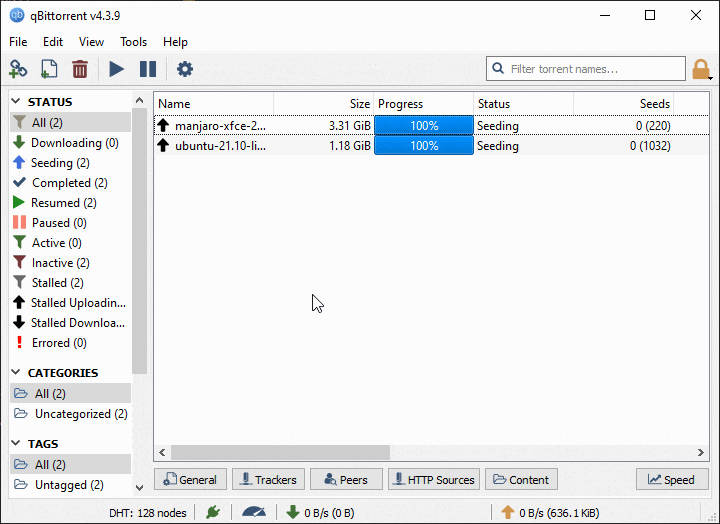

# qBt Migrate


qBt Migrate changes the save paths of all your existing torrents in qBittorrent in one go.
Use it when you move your downloads to a new drive, folder, or machine, so qBittorrent finds
them again without re-adding every torrent. It can also convert slashes when you move
between Windows and Linux/Mac.



## Contents
* [Quick start](#quick-start)
* [Installation](#installation)
* [Usage](#usage)
* [Options](#options)
* [Safety](#safety)
* [Where BT_backup is](#where-bt_backup-is)
* [Paths and slashes](#paths-and-slashes)
* [Docker details](#docker-details)
* [Exit codes](#exit-codes)
* [Python module](#python-module)
* [Contributing](#contributing)
* [Also by the author](#also-by-the-author)

## Quick start
1. **Fully quit qBittorrent** (`File` -> `Exit`, or the tray icon). Closing the window is not enough.
   If qBittorrent runs in Docker, stop its container, see [Safety](#qbittorrent-must-be-closed).
2. **Preview** with `--dry-run`. Nothing is written.
3. **Run it for real** with the same arguments, minus `--dry-run`. A backup zip of
   `BT_backup` is made first.
4. **Start qBittorrent** and check a few torrents. If something looks wrong, see
   [Undo a run](#undo-a-run).

`-e` is the path as qBittorrent has it stored, not where the files are on disk today. You
can see it in a torrent's **General** tab (**Save Path**), or right-click the column header
of the torrent list and tick **Save Path**. `-n` is the path qBittorrent should use from
now on. Moving between Windows and Linux/Mac? Add `-t`, see [Usage](#usage).

With pip, on Linux/Mac:

```sh
pip install qbt_migrate
qbt_migrate -e /old/torrents -n /new/torrents --dry-run
qbt_migrate -e /old/torrents -n /new/torrents
```

With pip, on Windows (`cmd` or PowerShell):

```bat
pip install qbt_migrate
qbt_migrate -e X:\Torrents -n Z:\Torrents --dry-run
qbt_migrate -e X:\Torrents -n Z:\Torrents
```

Anything you leave off is asked for. In a terminal it also asks whether the paths are
regex patterns and for the target OS: press Enter for both (no regex, auto-detect), and
Enter again to accept the `BT_backup` path shown.

With Docker, on a Linux host (mount your `BT_backup` at `/tmp/BT_backup`):

```sh
docker run --rm -v "$HOME/.local/share/qBittorrent/BT_backup:/tmp/BT_backup" jslay88/qbt_migrate -e /old/torrents -n /new/torrents --dry-run
docker run --rm -v "$HOME/.local/share/qBittorrent/BT_backup:/tmp/BT_backup" jslay88/qbt_migrate -e /old/torrents -n /new/torrents
```

With Docker, on a Windows host (`cmd`; in PowerShell write `$env:LOCALAPPDATA`):

```bat
docker run --rm -v "%LOCALAPPDATA%/qBittorrent/BT_backup:/tmp/BT_backup" jslay88/qbt_migrate -e X:\Torrents -n Z:\Torrents --dry-run
docker run --rm -v "%LOCALAPPDATA%/qBittorrent/BT_backup:/tmp/BT_backup" jslay88/qbt_migrate -e X:\Torrents -n Z:\Torrents
```

> [!WARNING]
> The container cannot see a qBittorrent running on the host, so it cannot check for
> you. Make sure it is closed before the real run.

If paths don't come out the way you expect, read [Paths and slashes](#paths-and-slashes)
before anything else.

## Installation
### pip
You need [Python](https://www.python.org/downloads/) 3.10 or newer and
[pip](https://pip.pypa.io/en/stable/installation/). Install from PyPI:

```sh
pip install qbt_migrate
```

This gives you the `qbt_migrate` command. Run it and follow the prompts, or pass
everything as arguments.

* `pip` not found: use `python3 -m pip` on Linux/Mac, or `py -m pip` on Windows.
* pip refuses with `externally-managed-environment` (common on Linux distributions), or
  `qbt_migrate` is not found after installing: install it with
  [pipx](https://packaging.python.org/en/latest/guides/installing-stand-alone-command-line-tools/)
  instead, `pipx install qbt_migrate`, which also puts the command on your `PATH`.

### Docker
Use [Docker](https://docs.docker.com/get-started/get-docker/) if you don't have Python, or don't want to install the package on your system
directly. The image has all the functionality of the pip install and takes the same
arguments.

Images are published for `linux/amd64` and `linux/arm64` to both registries:

* `jslay88/qbt_migrate` (Docker Hub)
* `ghcr.io/jslay88/qbt_migrate` (GitHub Container Registry)

Tags: `latest` and `X.Y.Z` track releases, `master` tracks the default branch.

See [Docker details](#docker-details) for mounting `BT_backup` and the other options.

## Usage
The examples assume your torrents are in `X:\Torrents` when coming from Windows, or
`/torrents` when coming from Linux/Mac.

| Situation | Command |
| --- | --- |
| New drive letter (Windows) | `qbt_migrate -e X:\ -n Z:\ -t Windows` |
| New folder on the same drive (Windows) | `qbt_migrate -e X:\Torrents -n X:\NewDir\Torrents -t Windows` |
| New drive and folder (Windows) | `qbt_migrate -e X:\Torrents -n Z:\NewDir\Torrents -t Windows` |
| New folder (Linux/Mac) | `qbt_migrate -e /torrents -n /new/path/for/torrents` |
| Windows library moving to Linux/Mac, run on Linux/Mac | `qbt_migrate -e 'X:\Torrents' -n /torrents -t Linux` |
| Linux/Mac library moving to Windows, run on Windows | `qbt_migrate -e /torrents -n Z:\Torrents -t Windows` |

The Windows rows are typed in `cmd` or PowerShell. On Linux/Mac, single-quote Windows
paths (see [Paths and slashes](#paths-and-slashes)).

`-t` converts slashes for the target OS. Leave it off and it is auto-detected, but only
when one of the two paths has `\` and the other has `/`.

### More examples
Running on Windows (`cmd` or PowerShell), where a single `\` is fine:

| Example | Command |
| --- | --- |
| Windows to Windows (drive letter change) | `qbt_migrate -e X:\ -n Z:\ -t Windows` |
| Windows to Windows (directory change) | `qbt_migrate -e X:\Torrents -n X:\NewDir\Torrents -t Windows` |
| Windows to Windows (drive letter change with directory change) | `qbt_migrate -e X:\Torrents -n Z:\NewDir\Torrents -t Windows` |
| Windows to Linux/Mac (converts slashes). Note the trailing slash | `qbt_migrate -e X: -n /torrents -t Linux` |
| Windows to Linux/Mac (converts slashes) | `qbt_migrate -e X:\Torrents -n /torrents -t Linux` |
| Linux/Mac to Windows (converts slashes) | `qbt_migrate -e /torrents -n Z:\Torrents -t Windows` |

Running on Linux/Mac, where Windows paths need a doubled `\\` or single quotes:

| Example | Command |
| --- | --- |
| Changes torrent root path on Linux/Mac | `qbt_migrate -e /torrents -n /new/path/for/torrents` |
| Windows to Linux/Mac (converts slashes). Note the trailing slash | `qbt_migrate -e X: -n /torrents -t Linux` |
| Windows to Linux/Mac (converts slashes) | `qbt_migrate -e X:\\Torrents -n /torrents -t Linux` |
| Same, single-quoted | `qbt_migrate -e 'X:\Torrents' -n /torrents -t Linux` |
| Linux/Mac to Windows (converts slashes) | `qbt_migrate -e /torrents -n Z:\\Torrents -t Windows` |

The commands are kept free of inline comments, since `&::` in PowerShell and `#` in an
interactive zsh (the macOS default) would be read as part of the command.

### Advanced: regex
With `-r` / `--regex`, the existing and new paths are regex patterns. Capture groups are
recommended. This example replaces `/some/test/with/a/path` with `/test/matched/path`:

```sh
qbt_migrate -r -e '/some/(\w+)/with/a/path' -n '/\1/matched/path' -t Linux
qbt_migrate --regex -e '/some/(\w+)/with/a/path' -n '/\1/matched/path' -t Linux
```

The pattern is applied to every path in the file, including renamed files
(`mapped_files`). Avoid a trailing `.*$`: it swallows the rest of each path, so every
file of a torrent would end up with the same path.

Pass `-t` in regex mode. Without it, a `\1` in the new path can make auto-detect think the
target is Windows, and the result is written with backslashes (`\test\matched\path`).

Separators are not matched both ways in regex mode. See [docs/paths.md](docs/paths.md#regex-mode-is-a-separate-contract).

### Prompts and scripts
Anything not passed as an argument is prompted for. When nothing is attached to stdin
(a container without `-it`, cron, a shell script), `qbt_migrate` does not prompt: it uses
the defaults it can (platform `BT_backup` path, no regex, target OS auto-detected) and
exits with a message naming the argument if `-e` or `-n` is missing.

## Options
<details>
<summary>Full <code>qbt_migrate --help</code> output</summary>

```text
usage: qbt_migrate [-h] [-e EXISTING_PATH] [-n NEW_PATH] [-r] [-t {Windows,Linux,Mac}] [-b BT_BACKUP_PATH] [-s] [-k] [--ignore-running] [-d] [-z]
                   [-l {DEBUG,INFO}] [-v]

options:
  -h, --help            show this help message and exit
  -e EXISTING_PATH, --existing-path EXISTING_PATH
                        Existing root of path to look for.
  -n NEW_PATH, --new-path NEW_PATH
                        New root path to replace existing root path with.
  -r, --regex           Existing and New paths are regex patterns. (Capture groups recommended).
  -t {Windows,Linux,Mac}, --target-os {Windows,Linux,Mac}
                        Target OS (converts slashes). Default will auto-detect if conversion is needed based on existing vs new.
  -b BT_BACKUP_PATH, --bt-backup-path BT_BACKUP_PATH
                        BT_backup Path Override.
  -s, --skip-bad-files  Skips bad .fastresume files instead of exiting. Default behavior is to exit.
  -k, --stop-qbittorrent
                        Stop a running qBittorrent without asking first, and wait for it to exit.
  --ignore-running      Run even if qBittorrent is still running. Unsafe: it will overwrite your changes from memory when it exits.
  -d, --dry-run         Show what would change and exit without writing anything.
  -z, --skip-backup     Skips creating a backup zip archive of the BT_backup folder. Default behavior is to create a backup.
  -l {DEBUG,INFO}, --log-level {DEBUG,INFO}
                        Log Level, Default is INFO.
  -v, --version         Prints the current version number and exits.
```

</details>

## Safety
### qBittorrent must be closed
qBittorrent must be closed before `qbt_migrate` writes anything. It keeps resume data in
memory and writes `.fastresume` files back out when it exits, so editing them underneath a
running client just gets your changes overwritten.

`qbt_migrate` checks for this and refuses to write while it finds qBittorrent running.
Interactively it offers to stop it for you; pass `-k` / `--stop-qbittorrent` to skip the
question. Either way it sends a normal quit (never a force kill, which would skip the
resume data flush) and waits for the process to actually disappear before touching
anything. `--ignore-running` overrides the check if you know better.

`--dry-run` is exempt, since it writes nothing.

> [!NOTE]
> Detection is best effort. Inside a container `/proc` only shows the container's own
> processes, so a qBittorrent running on the host is invisible to it. Close it yourself
> when running via Docker.

* **Desktop:** qBittorrent closes to the notification area by default
  ([`CloseToTray` defaults to true](https://github.com/qbittorrent/qBittorrent/blob/master/src/base/preferences.cpp)),
  so closing the window leaves it running. Use `File` -> `Exit` or quit from the tray icon.
* **qBittorrent in Docker:** stop its container, for example
  `docker stop -t 60 qbittorrent`. Docker kills a container that has not exited after
  [10 seconds by default](https://docs.docker.com/reference/cli/docker/container/stop/),
  and a large library can need longer to save its resume data.

### Automatic backup
A backup zip archive of the `BT_backup` folder is automatically created inside the
`BT_backup` directory before anything is changed. Pass `-z` / `--skip-backup` to skip it,
which is worth doing when you already have one and are making a series of path changes
over a large library, since zipping every run gets slow.

### Undo a run
Quit qBittorrent, then extract the newest `fastresume_backup<date>.zip` from `BT_backup`
into `BT_backup` itself, replacing the files there. The zip holds the `.fastresume` and
`.torrent` files as they were before the run.

### Unreadable files
By default `qbt_migrate` stops at a `.fastresume` file it cannot read. Pass `-s` /
`--skip-bad-files` to skip those files and migrate the rest.

### Check before you commit to it
Pass `-d` / `--dry-run` to see exactly what would change, per file and per key, without
writing anything. Trailing separators are the most common way to get this wrong, so values
are quoted to make them visible.

```text
$ qbt_migrate -e 'S:\' -n /mnt/s/ --dry-run
Auto detected target OS change. Will convert slashes to Linux/Mac.
🔍 Dry run. Searching for .fastresume files with path S:\ ...
Ubuntu 24.04.1 LTS Desktop (amd64)
    save_path         'S:\Pictures\' -> '/mnt/s/Pictures/'
    qBt-savePath      'S:\Pictures\' -> '/mnt/s/Pictures/'
    qBt-downloadPath  'S:\Incomplete\' -> '/mnt/s/Incomplete/'
    mapped_files      2 of 2 entries, e.g. 'S:\Pictures\a.jpg' -> '/mnt/s/Pictures/a.jpg'
🔍 1 of 1 relevant fastresume file would be updated. Nothing was written.
```

Torrents are identified by name rather than by the info hash their `.fastresume` is
named after. The name comes from `qBt-name`, then libtorrent's `name`, then the sibling
`<hash>.torrent`, falling back to the hash when none of those exist (a magnet with no
metadata yet).

Large libraries list the first 20 files and a count of the rest. Add `-l DEBUG` to see all
of them.

## Where BT_backup is
By default, everything happens in the `BT_backup` directory of the OS `qbt_migrate` is
running on. Use `-b` / `--bt-backup-path` to point it somewhere else.

Default `BT_backup` paths, checked in this order and matching how qBittorrent itself
resolves them:
* Windows: `%LOCALAPPDATA%\qBittorrent\BT_backup`
* Mac: `$HOME/Library/Application Support/qBittorrent/BT_backup`
* Linux: `$XDG_DATA_HOME/qBittorrent/BT_backup` (`$HOME/.local/share` when unset),
  falling back to the pre-4.x `$XDG_DATA_HOME/data/qBittorrent/BT_backup` when only
  that one exists
* Docker: `/config/qBittorrent/BT_backup`, checked first when `qbt_migrate` itself runs
  inside a container (for example inside a qBittorrent container). The `jslay88/qbt_migrate`
  image does not use this: mount `BT_backup` at `/tmp/BT_backup` there, see
  [Docker details](#docker-details).

Run with `-l DEBUG` to see which path was picked, and, when none of them exists, which
ones were checked.

**qBittorrent itself running in Docker** (for example the
[linuxserver image](https://docs.linuxserver.io/images/docker-qbittorrent/)): `BT_backup`
is in the host folder you mapped to `/config`, under `qBittorrent/BT_backup`. That is the
folder to mount or pass to `-b`. The save paths inside are the paths qBittorrent sees
inside its container (such as `/downloads/...`), so use those for `-e` and `-n`.

> [!NOTE]
> `qbt_migrate` edits the `.fastresume` files in `BT_backup`. If qBittorrent's
> **Resume data storage type** (Advanced settings) is set to **SQLite database**, it keeps
> resume data in `torrents.db` next to `BT_backup` instead, and `qbt_migrate` does not
> edit that database.

## Paths and slashes
Most path problems come down to these:

* **Shell escaping.** On Linux/Mac, `\` is the shell's escape character, so Windows paths
  need a doubled `\\` or single quotes: `C:\\Users\\user\\Downloads\\Torrents` or
  `'C:\Users\user\Downloads\Torrents'`. This also applies when running the Docker image
  from a Linux/Mac shell. On Windows `cmd` and PowerShell a single `\` is fine.
* **Trailing slashes.** Replacement is a plain substring swap, so the trailing slash has to
  match on both sides. `-e 'X:\' -n /torrents` will result in `/torrentsxxxxx`, not
  `/torrents/xxxxx`. The correct pattern for this would be `-e X: -n /torrents -t Linux` or
  `-e 'X:\' -n /torrents/`.
* **Matches anywhere in the path.** The existing path is not only matched at the start:
  `-e /data -n /new` also turns `/srv/data/x` into `/srv/new/x`. Use a path that is
  specific enough, and check with `--dry-run`.
* **Mixed separators** in stored paths are matched for you: `-e 'S:\'` and `-e 'S:/'` find
  the same files.
* **Pass `-t` when moving between Windows and Linux/Mac.** Auto-detect only fires when one
  path has `\` and the other has `/`. With `-e X:` or `-e 'S:/'` it does not, and the
  rest of the path keeps its old separators (`/torrents\Torrents\movie`).

Quoting per shell:

| Shell | Windows paths | Regex (`-r`) |
| --- | --- | --- |
| bash, zsh (Linux/Mac) | `'X:\Torrents'` or `X:\\Torrents` | single quotes: `'/some/(\w+)/.*$'` |
| PowerShell | `X:\Torrents` or `'X:\Torrents'` | single quotes, `(` is special unquoted |
| cmd | `X:\Torrents`, no quotes needed | no quotes needed, unless the pattern has `^ \| & < >`: then double quotes |

In `cmd`, single quotes are passed through as part of the path, so leave them off. If a
path has spaces, use double quotes and leave off a trailing `\` inside them:
`"X:\My Torrents"` works, `"X:\My Torrents\"` does not, because
[`\"` reads as a literal quote](https://learn.microsoft.com/en-us/cpp/c-language/parsing-c-command-line-arguments).

[docs/paths.md](docs/paths.md) covers escaping, separators, and trailing slashes in full.
If paths are not being replaced the way you expect, read that first.

## Docker details
### Mounting BT_backup
Inside the container the `BT_backup` path is automatically overridden to `/tmp/BT_backup`,
so mount your `BT_backup` there.

Add `-it` if you want to be prompted for anything you leave off. Without it, arguments you
omit fall back to their defaults instead of prompting.

For example, mounting in the default `BT_backup` path on a Windows machine running Docker
(`cmd`; in PowerShell write `$env:LOCALAPPDATA` instead of `%LOCALAPPDATA%`):

```bat
docker run --rm -v "%LOCALAPPDATA%/qBittorrent/BT_backup:/tmp/BT_backup" jslay88/qbt_migrate -e X:\ -n Z:\
docker run --rm -v "%LOCALAPPDATA%/qBittorrent/BT_backup:/tmp/BT_backup" jslay88/qbt_migrate -e X:\Torrents -n X:\NewDir\Torrents -t Windows
```

Mounting in the default `BT_backup` path on a Linux machine running Docker (Windows
paths single-quoted, see [Paths and slashes](#paths-and-slashes)):

```sh
docker run --rm -v "$HOME/.local/share/qBittorrent/BT_backup:/tmp/BT_backup" jslay88/qbt_migrate -e 'X:\' -n 'Z:\'
docker run --rm -v "$HOME/.local/share/qBittorrent/BT_backup:/tmp/BT_backup" jslay88/qbt_migrate -e 'X:\Torrents' -n 'X:\NewDir\Torrents' -t Windows
```

On a Mac the default path is `$HOME/Library/Application Support/qBittorrent/BT_backup`;
keep the quotes, it has a space:

```sh
docker run --rm -v "$HOME/Library/Application Support/qBittorrent/BT_backup:/tmp/BT_backup" jslay88/qbt_migrate -e 'X:\' -n 'Z:\'
```

The examples under [Usage](#usage) work the same way: put the `qbt_migrate` arguments
after the image name.

### Using a different mount point
If for some reason you want to override the `BT_backup` path from `/tmp/BT_backup` within
the container, set the environment variable `BT_BACKUP_PATH` on the container to where you
will be mounting it.

> [!WARNING]
> The `-e` for the environment variable must go **before** the image name
> `jslay88/qbt_migrate`. A `-e` after the image is `qbt_migrate`'s `--existing-path`.

```bat
docker run --rm -v "%LOCALAPPDATA%/qBittorrent/BT_backup:/opt/qbt_migrate/fastresume" -e BT_BACKUP_PATH=/opt/qbt_migrate/fastresume jslay88/qbt_migrate -e X:\ -n Z:\
```

### Building the image yourself
You can also clone this repository, build the image, and run your own built image:

```bat
docker build . -t qbt_migrate
docker run --rm -v "%LOCALAPPDATA%/qBittorrent/BT_backup:/tmp/BT_backup" qbt_migrate -e X:\ -n Z:\
```

## Exit codes
* `0` success
* `1` one or more `.fastresume` files could not be read or updated
* `2` bad or missing arguments, a `BT_backup` path that is not a directory, or
  qBittorrent still running (not stopped, or you declined to stop it)

## Python module
This project has also been built to be modular and used as a Python module. If you feel
like utilizing this project within your own, please feel free to do so, and let me know!

Use cases:
* UI for qbt_migrate
* `FastResume` class
* Torrent manager

## Contributing
See [CONTRIBUTING.md](CONTRIBUTING.md). `tox -e lint` and `tox -e unittest` are what CI runs.

## Also by the author
A Chrome extension for handling TV episode torrents, **qBt TV Torrent Upload**:
[Chrome Web Store](https://chrome.google.com/webstore/detail/qbt-tv-torrent-upload/fhoodbpeaagldkgefdpcnilmjjncihpf)
· [Source](https://github.com/jslay88/qbt_tv_torrent_uploader)
